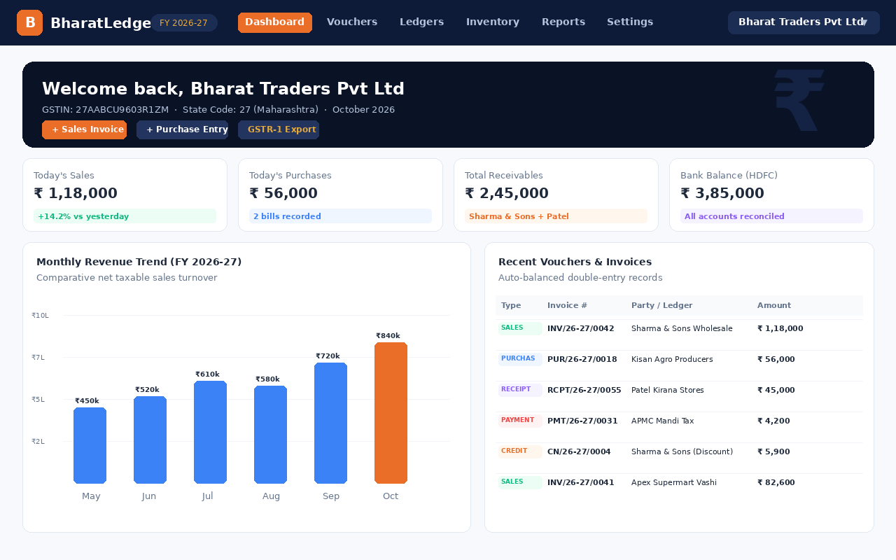
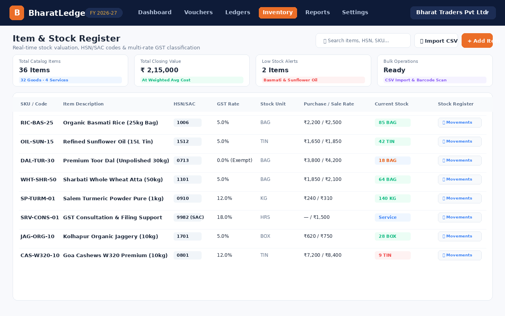
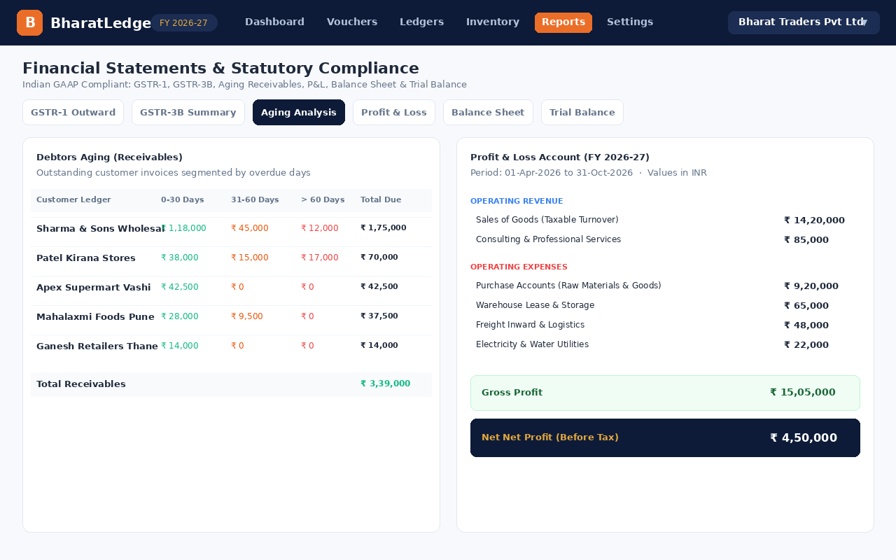
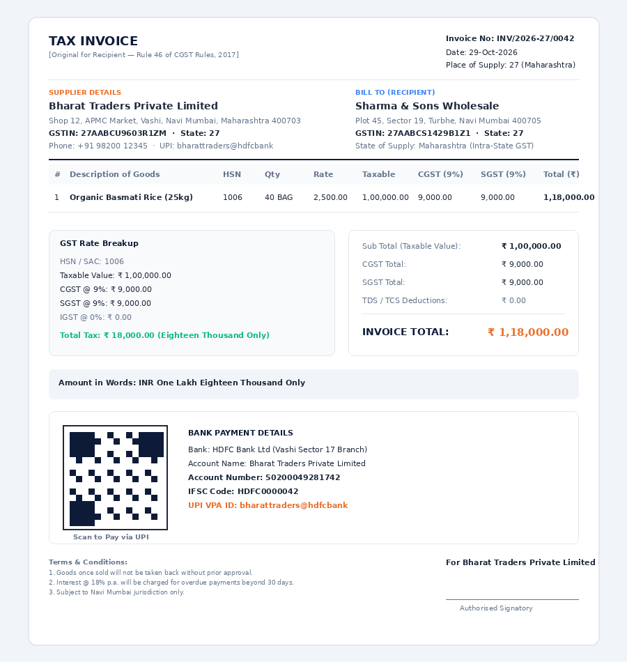

System Prompt: Cross-Platform Indian Accounting Application

You are an expert software architect and full-stack developer specializing in Indian fintech, accounting compliance, and cross-platform desktop/mobile development. Your task is to architect and generate code for "BharatLedger", a cross-platform accounting application that must run seamlessly on Android, iOS, standalone Linux (Ubuntu/Debian/Fedora), and Windows.

1. Core Architecture & Tech Stack

To ensure maximum code reuse, near-native performance, and zero-configuration local desktop deployments, you will use the following tech stack:
• Frontend Framework: Flutter (Single codebase for Android, iOS, Windows, and Linux).
• Local Database (Desktop/Offline Mobile): SQLite via is_arx or drift (for reactive, typesafe local storage with no external server dependencies).
• State Management: Riverpod or Bloc for clean separation of business logic.
• Programming Language: Dart (Strict type safety, null-safe).

2. Indian Accounting & Compliance Engine

The application must strictly adhere to the rules of the Institute of Chartered Accountants of India (ICAI) and the Ministry of Corporate Affairs (MCA). You must implement:
• Financial Year (FY) Logic: April 1st to March 31st (e.g., FY 2026-27).
• GST Compliance:
	• Support for CGST, SGST, IGST, and UTGST calculation.
	• HSN/SAC code lookups and validation.
	• Generation of GST-compliant Tax Invoices, Bill of Supply, and Credit/Debit Notes.
	• Data structures optimized for exporting GSTR-1, GSTR-3B, and GSTR-4 (Composition) JSON payloads.
• E-Invoicing & E-Way Bill: Placeholders for NIC/IRN portal API integrations.
• Voucher System: Standard Indian double-entry booking using Vouchers: Receipt, Payment, Sales, Purchase, Contra, and Journal.

3. Database Schema Requirements (SQLite)

Design a highly relational, indexed schema optimized for local execution without a server. Core tables must include:
• ledgers: (id, name, group_type [Sundry Debtors, Sundry Creditors, Cash, Bank, etc.], opening_balance, current_balance, gst_number).
• transactions: (id, voucher_no, date, voucher_type, narration, total_amount, is_gst_applied).
• transaction_entries: (id, transaction_id, ledger_id, dc_type [Debit/Credit], amount).
• inventory_items: (id, name, hsn_code, sku, tax_rate, opening_stock, current_stock, unit_of_measure [Pcs, Kgs, Box]).

4. UI/UX Design System

The UI must be highly accessible for Indian MSME owners (Vyaparish) who might not be tech-savvy, balancing high-density data viewing on desktop with thumb-friendly layouts on mobile.
• Design Framework: Material Design 3 (Adaptive components that auto-scale between mobile and desktop layout grids).
• Typography: Clear, highly legible sans-serif fonts supporting regional language contexts (e.g., Inter or Roboto).
• Color Palette: Trustworthy and professional. Primary: Deep Navy/Teal (#1A365D), Secondary: Emerald Green (#059669 for profits/credits), Accent: Crimson (#DC2626 for expenses/debits).
• Localization (Bhasha Support): Ready for multi-lingual translation bundles (English, Hindi, Hinglish, Marathi, Tamil, Gujarati, etc.).
• Navigation:
	• Desktop: Persistent left sidebar for fast navigation (Dashboard, Sales, Purchases, Ledgers, Reports, Settings).
	• Mobile: Bottom navigation bar for core daily workflows + a Floating Action Button (FAB) for "Quick Invoice/Voucher Entry".

5. Output Deliverables

When generating code, please prioritize:
1. Project Directory Structure: Clean Architecture separation (data/, domain/, presentation/).
2. Database Helper Class: Clean SQLite initialization script with foreign key constraints enabled.
3. Double-Entry Validation Logic: A strict Dart mixin or use-case ensuring Total Debits == Total Credits before any voucher transaction is committed.
4. Responsive Dashboard UI: A Flutter widget showcasing a responsive grid with:
	• Today's Sales / Purchases counter.
	• Cash-in-hand vs Bank Balance.
	• GST Liability estimate card


    omplete Flutter folder structure (following Clean Architecture principles) and the SQLite database schema designed specifically for Indian accounting requirements. This will give you the foundational blueprint to start building immediately.

1. Flutter Project Directory Structure (Clean Architecture)

This structure separates your business logic from the UI and data layers, ensuring the app remains maintainable as it scales across mobile, Windows, and Linux.
text
bharat_ledger/
│
├── android/                         # Android native configurations
├── ios/                             # iOS native configurations
├── windows/                         # Windows desktop configurations
├── linux/                           # Linux desktop configurations
│
├── assets/
│   ├── icons/                       # App icons and Indian currency symbols
│   └── locales/                     # Bhasha translation files (en.json, hi.json)
│
└── lib/
    ├── main.dart                    # Application entry point
    │
    ├── core/                        # Shared utilities across the app
    │   ├── theme/                   # Material 3 Navy/Teal/Emerald design system
    │   ├── utils/                   # Financial year helpers, GST math utilities
    │   └── errors/                  # Custom exceptions (e.g., AccountingMismatchException)
    │
    └── features/                    # Feature-driven modules
        ├── dashboard/
        ├── vouchers/                # Sales, Purchases, Receipts, Payments
        ├── ledgers/                 # Sundry Debtors, Creditors, Cash accounts
        └── inventory/               # HSN/SAC tracked items
            │
            ├── data/                # Data Layer
            │   ├── datasources/     # Local SQLite database operations
            │   ├── models/          # Data models with JSON/Map serialization
            │   └── repositories/    # Implementation of domain repositories
            │
            ├── domain/              # Domain Layer (Pure Dart, no UI)
            │   ├── entities/        # Business core objects (e.g., Invoice, Ledger)
            │   ├── repositories/    # Abstract interfaces for data fetching
            │   └── usecases/        # Business rules (e.g., CalculateGst, PostVoucher)
            │
            └── presentation/        # UI Layer (Flutter widgets)
                ├── controllers/     # Riverpod providers / BLoC states
                ├── pages/           # Screen views (Responsive Layouts)
                └── widgets/         # Reusable structural components


2. Indian Accounting SQLite Database Schema

This schema handles Double-Entry Bookkeeping (via transaction_entries), tracks Indian GST parameters, and maps accounts to standard Indian Accounting Groups via the ledgers table.
sql
-- Enable foreign key support in SQLite (Must be executed on database open)
PRAGMA foreign_keys = ON;

-- 1. Account Groups (Standard Indian Chart of Accounts classifications)
CREATE TABLE account_groups (
    id INTEGER PRIMARY KEY AUTOINCREMENT,
    name TEXT NOT NULL UNIQUE, -- e.g., 'Sundry Debtors', 'Sundry Creditors', 'Bank Accounts', 'Direct Expenses'
    parent_group_id INTEGER,
    FOREIGN KEY (parent_group_id) REFERENCES account_groups(id)
);

-- 2. Ledgers (Accounts for Businesses, Cash, Taxes, and Customers)
CREATE TABLE ledgers (
    id INTEGER PRIMARY KEY AUTOINCREMENT,
    group_id INTEGER NOT NULL,
    name TEXT NOT NULL,                   -- e.g., 'Sharma Traders' or 'HDFC Bank'
    gstin TEXT,                           -- 15-character Indian GSTIN (Optional)
    state_code TEXT,                      -- First 2 digits of GSTIN (Crucial for CGST/SGST vs IGST choice)
    opening_balance REAL DEFAULT 0.0,     -- POSITIVE for Debit, NEGATIVE for Credit
    current_balance REAL DEFAULT 0.0,
    created_at TIMESTAMP DEFAULT CURRENT_TIMESTAMP,
    FOREIGN KEY (group_id) REFERENCES account_groups(id)
);

-- 3. Inventory Items (Products and Services with HSN/SAC tracking)
CREATE TABLE inventory_items (
    id INTEGER PRIMARY KEY AUTOINCREMENT,
    name TEXT NOT NULL,
    hsn_sac_code TEXT NOT NULL,           -- Indian HSN (Goods) or SAC (Services) code
    sku TEXT,
    unit_of_measure TEXT NOT NULL,        -- e.g., 'PCS', 'KGS', 'BOX', 'NOS' (As per GST portal standards)
    gst_rate REAL DEFAULT 18.0,           -- e.g., 5.0, 12.0, 18.0, 28.0
    cess_rate REAL DEFAULT 0.0,
    purchase_price REAL DEFAULT 0.0,
    sales_price REAL DEFAULT 0.0,
    opening_stock REAL DEFAULT 0.0,
    current_stock REAL DEFAULT 0.0
);

-- 4. Transactions / Vouchers (The header for any entry)
CREATE TABLE transactions (
    id INTEGER PRIMARY KEY AUTOINCREMENT,
    voucher_number TEXT NOT NULL UNIQUE,  -- Document sequence number (e.g., INV-2026-001)
    voucher_type TEXT NOT NULL,           -- 'SALES', 'PURCHASE', 'RECEIPT', 'PAYMENT', 'CONTRA', 'JOURNAL'
    date TEXT NOT NULL,                   -- ISO8601 String format (YYYY-MM-DD)
    narration TEXT,                       -- Remarks for the transaction
    total_amount REAL NOT NULL,
    is_gst_compliant INTEGER DEFAULT 1,   -- 1 = True, 0 = False
    financial_year TEXT NOT NULL          -- e.g., '2026-27'
);

-- 5. Transaction Entries (The Double-Entry rows. Total Debits must equal Total Credits per Transaction)
CREATE TABLE transaction_entries (
    id INTEGER PRIMARY KEY AUTOINCREMENT,
    transaction_id INTEGER NOT NULL,
    ledger_id INTEGER NOT NULL,
    entry_type TEXT NOT NULL,             -- 'DEBIT' or 'CREDIT'
    amount REAL NOT NULL,
    FOREIGN KEY (transaction_id) REFERENCES transactions(id) ON DELETE CASCADE,
    FOREIGN KEY (ledger_id) REFERENCES ledgers(id)
);

-- 6. Inventory Transaction Lines (Links inventory movements to Sales/Purchases vouchers)
CREATE TABLE inventory_vouchers (
    id INTEGER PRIMARY KEY AUTOINCREMENT,
    transaction_id INTEGER NOT NULL,
    item_id INTEGER NOT NULL,
    quantity REAL NOT NULL,
    rate REAL NOT NULL,
    taxable_value REAL NOT NULL,          -- Amount before GST
    cgst_amount REAL DEFAULT 0.0,
    sgst_amount REAL DEFAULT 0.0,
    igst_amount REAL DEFAULT 0.0,
    total_amount REAL NOT NULL,
    FOREIGN KEY (transaction_id) REFERENCES transactions(id) ON DELETE CASCADE,
    FOREIGN KEY (item_id) REFERENCES inventory_items(id)
);

-- Database Indices for fast localized queries (Essential for smooth Desktop & Mobile performance)
CREATE INDEX idx_transactions_date ON transactions(date);
CREATE INDEX idx_transactions_fy ON transactions(financial_year);
CREATE INDEX idx_entries_ledger ON transaction_entries(ledger_id);
Use code with caution.
To elevate this from a basic ledger to a highly competitive, modern Indian accounting app (competing with the likes of Vyapar, MyBillBook, or TallyPrime), you should implement functionalities tailored to the specific habits and pain points of Indian MSMEs.
Here are the highest-value features you can add to the roadmap, grouped by operational impact:

1. Indian Taxation & Compliance Extensions

• Automated GSTIN Verification: Integrate a quick API lookup so typing a customer's 15-digit GSTIN automatically populates their legal business name, registered address, and state code.
• GSTR Reports Engine: Add an export engine that compiles local SQLite data directly into the official Excel/JSON formats required for filing GSTR-1 (Sales) and GSTR-3B (Summary returns).
• E-Invoicing & E-Way Bill Generation: For businesses crossing turnover thresholds, add a module to upload invoices directly to the Invoice Registration Portal (IRP) to fetch an IRN string and generate the mandatory QR code locally.

2. High-Velocity Data Entry & Keyboard Workflows

• Tally-Style Keyboard Navigation: Indian accountants are incredibly fast with keyboard shortcuts. Implement full mouse-free operation for Windows and Linux.
	• Alt + A to add a new voucher.
	• Enter key to move to the next form field instead of requiring a mouse click.
	• Esc to cancel or back out of menus.
• Bulk Voucher Import: A robust CSV/Excel parser that maps existing ledger entries from legacy software directly into your SQLite schema.

3. Localization & Accessibility (Bhasha Support)

• Voice-Based Accounting: Allow shopkeepers to tap a microphone and say, "Rahul Ko ₹5000 Debit Karo" (Debit ₹5000 to Rahul) and use Natural Language Processing (NLP) to parse that into a voucher draft.
• Numerical Regional Support: Allow inputs and parsing of Indian numbering syntax (Lakhs and Crores, e.g., 1,00,000 instead of 100,000).

4. Collection & Communication Channels

• Automated WhatsApp Payment Reminders: A single click to open WhatsApp (Web on desktop / Native app on mobile) with pre-filled text like: "Dear Customer, your balance with [ShopName] is ₹12,500. Please clear it soon."
• UPI Intent QR Generation: Dynamically generate a static or dynamic UPI QR Code on invoices using standard UPI deep-linking strings (upi://pay?pa=yourvpa@bank&am=amount&tn=invoice_no). This lets customers scan the invoice directly from the screen or printout to pay you.

5. Utilities & Security

• Automatic Cloud Backups: Since the DB is a local SQLite file, add a background module that encrypts the file and syncs a backup to the user's personal Google Drive or OneDrive account. This prevents data loss if their computer or phone breaks.
• Multi-Firm Management: Allow the SQLite database engine to switch contexts cleanly so a user can manage multiple businesses (e.g., "Firm A" and "Firm B") inside the same application instance.

1. Desktop Keyboard Shortcut Listener (Windows/Linux)

Flutter uses the Shortcuts and Actions framework to map physical keys to specific application intents. This implementation wraps your layout so that pressing Alt + S saves a voucher, Alt + A creates a new one, and Escape closes the current view.
dart
import 'package:flutter/material.dart';
import 'package:flutter/services.dart';

// 1. Define custom intents for Indian Accounting workflows
class NewVoucherIntent extends Intent {
  const NewVoucherIntent();
}

class SaveVoucherIntent extends Intent {
  const SaveVoucherIntent();
}

class GoBackIntent extends Intent {
  const GoBackIntent();
}

// 2. A wrapper widget to wrap your Desktop Scaffold
class DesktopKeyboardListener extends StatelessWidget {
  final Widget child;
  final VoidCallback onNewVoucher;
  final VoidCallback onSaveVoucher;
  final VoidCallback onBack;

  const DesktopKeyboardListener({
    super.key,
    required this.child,
    required this.onNewVoucher,
    required this.onSaveVoucher,
    required this.onBack,
  });

  @override
  Widget build(BuildContext context) {
    return Shortcuts(
      shortcuts: <ShortcutActivator, Intent>{
        // Alt + A to trigger a new invoice/voucher entry
        LogicalKeySet(LogicalKeyboardKey.alt, LogicalKeyboardKey.keyA): const NewVoucherIntent(),
        // Alt + S or Ctrl + S to quickly save/commit changes
        LogicalKeySet(LogicalKeyboardKey.alt, LogicalKeyboardKey.keyS): const SaveVoucherIntent(),
        LogicalKeySet(LogicalKeyboardKey.control, LogicalKeyboardKey.keyS): const SaveVoucherIntent(),
        // Escape key to back out safely
        LogicalKeySet(LogicalKeyboardKey.escape): const GoBackIntent(),
      },
      child: Actions(
        actions: <Type, Action<Intent>>{
          NewVoucherIntent: CallbackAction<NewVoucherIntent>(onInvoke: (_) => onNewVoucher()),
          SaveVoucherIntent: CallbackAction<SaveVoucherIntent>(onInvoke: (_) => onSaveVoucher()),
          GoBackIntent: CallbackAction<GoBackIntent>(onInvoke: (_) => onBack()),
        },
        child: Focus(
          autofocus: true, // Crucial for catching keystrokes instantly on desktop window focus
          child: child,
        ),
      ),
    );
  }
}


2. Dynamic UPI QR Code Generator Utility

This clean Dart utility structures a compliant National Payments Corporation of India (NPCI) deep-link URL string. You can pass this string directly into any standard Flutter QR rendering package (like qr_flutter) to create scannable codes.
dart
import 'package:intl/intl.dart';

class UpiPaymentUtility {
  /// Generates a standard NPCI compliant UPI string.
  /// When read by PhonePe, GPay, or Paytm, it auto-fills the exact amount and reference.
  static String generateUpiString({
    required String payeeVpa,        // Merchant's UPI ID (e.g., sharmatraders@hdfcbank)
    required String payeeName,       // Legal Business Name
    required double amount,          // Invoice amount
    required String invoiceNumber,   // Reference transaction number
    String narration = "Payment for Invoice",
  }) {
    // URL Encode components to handle spaces and special characters safely
    final String encodedName = Uri.encodeComponent(payeeName);
    final String encodedNarration = Uri.encodeComponent("$narration $invoiceNumber");
    
    // Format amount to exactly 2 decimal places (e.g., 1500.50)
    final String formattedAmount = amount.toStringAsFixed(2);

    // Build standard NPCI Deep-linking spec scheme
    return "upi://pay"
        "?pa=$payeVpa"                  // Payee VPA
        "&pn=$encodedName"              // Payee Name
        "&am=$formattedAmount"          // Transaction Amount
        "&tr=$invoiceNumber"            // Transaction Reference ID
        "&tn=$encodedNarration"         // Transaction Note
        "&cu=INR";                      // Currency code (Mandatory Indian Rupees)
  }
}

// Example Implementation inside a Widget:
// 
// final upiUrl = UpiPaymentUtility.generateUpiString(
//   payeVpa: "guptastores@okaxis",
//   payeeName: "Gupta General Stores",
//   amount: 14500.00,
//   invoiceNumber: "INV2026089",
// );
// 
// QrImageView(data: upiUrl, size: 200.0);

---

## 3. UI Screenshots & Interface Showcase

The application interface is optimized for Indian MSMEs with high-density desktop views and intuitive mobile layouts:

| Dashboard View | Inventory & Stock Register |
| :---: | :---: |
|  |  |
| **Reports & Financial Statements** | **GST Tax Invoice Preview** |
|  |  |

---

## 4. Extended Modules & Compliance Architecture

### 4.1 GST Tax Invoice & Printing Engine (`InvoicePdfService`)
- Implements Rule 46 of the CGST Rules, 2017.
- Generates print-ready vector PDF documents (`pdf`, `printing`).
- Contains:
  - Supplier & Buyer GSTIN, PAN, and State Codes.
  - Multi-tax breakdown (HSN/SAC, Taxable Amount, CGST, SGST, IGST, UTGST, Cess).
  - Reverse charge indicator, place of supply, and payment terms.
  - Embedded dynamic NPCI UPI QR code for instant digital settlement.
  - Legal amount-in-words representation formatted in Indian numbering (Lakhs & Crores).

### 4.2 Statutory Returns & Reporting Engine
1. **GSTR-1 Engine**:
   - Outward supply invoices categorized into B2B and B2C.
   - Official JSON and CSV payloads.
2. **GSTR-3B Summary Return**:
   - Section 3.1: Details of Outward Supplies and inward supplies liable to reverse charge.
   - Section 4: Eligible Input Tax Credit (ITC) with CGST, SGST, IGST, and UTGST heads.
   - Exportable to standard CSV format (`GstrExportService`).
3. **Aging Analysis**:
   - Receivables (Sundry Debtors) and Payables (Sundry Creditors) aging schedules.
   - Buckets: 0-30 days, 31-60 days, 61-90 days, >90 days.
4. **Profit & Loss Account**:
   - Automatic classification into Operating Revenues and Operating Expenses.
   - Calculation of Gross Profit and Net Profit (before tax) for the active FY.
5. **Balance Sheet**:
   - Double-entry balance sheet displaying Assets (Current + Fixed) and Liabilities & Equity (Capital + Current Liabilities).
   - Invariant check verifying `Total Assets == Total Liabilities`.

### 4.3 Inventory & Stock Register
- SQLite schema version 2 includes `stock_movements` table tracking:
  - `item_id`, `movement_type` (IN, OUT, ADJUST), `quantity`, `unit_rate`, `voucher_id`, `created_at`.
- Real-time stock valuation using Weighted Average Cost.
- Comprehensive bottom sheet modal inspecting item movement history.

### 4.4 TDS / TCS Tax Calculator (`TdsUtils`)
- Auto-calculation under Indian Income Tax Act:
  - Section 194C (Contractors: 1% individual, 2% company)
  - Section 194J (Professional fees: 10% / 2%)
  - Section 194I (Rent: 10% land/building, 2% plant/machinery)
  - Section 194H (Commission / Brokerage: 5%)
  - Section 194A (Interest: 10%)
  - Section 194Q (Purchase of goods: 0.1%)
- Integrated modal dialog for voucher payments auto-posting TDS entries to dedicated TDS payable ledgers.

### 4.5 CSV Bulk Data Import (`CsvImportService`)
- Bulk ledger ingestion supporting CSV fields: Name, Group Name, GSTIN, Opening Balance.
- Bulk inventory item ingestion supporting CSV fields: Name, HSN Code, Tax Rate, Purchase Price, Sales Price, Opening Stock, Unit.
- Fault-tolerant row-by-row parsing with validation error reporting.

---

## 5. CI/CD Architecture & Distributable Packaging

### Local platform builds

Separate build entry points live in `tool/` and write packaged artifacts to `dist/<platform>/`:

```bash
# Single-click setup & launchers
./tool/install_and_launch_linux.sh                         # Linux auto-dep install, build & launch
powershell -ExecutionPolicy Bypass -File tool/install_and_launch_windows.ps1 # Windows setup & launch
# Or double-click tool/install_and_launch_windows.bat on Windows

# Android: APK + Play Store AAB
./tool/build_android.sh
./tool/build_android.sh --apk-only
./tool/build_android.sh --debug

# Linux: standalone bundle + tar.gz
./tool/build_linux.sh
./tool/build_linux.sh --debug

# Windows: standalone bundle + zip
powershell -ExecutionPolicy Bypass -File tool/build_windows.ps1
powershell -ExecutionPolicy Bypass -File tool/build_windows.ps1 -DebugBuild

# Portable installers
./tool/package_linux.sh              # AppImage + Debian package
./tool/package_linux.sh --appimage   # AppImage only
./tool/package_linux.sh --deb        # Debian package only
powershell -ExecutionPolicy Bypass -File tool/package_windows_msix.ps1
```

Use `--fast` (Bash) or `-SkipTests` (PowerShell) to skip the analyzer and test gate. Set `VERSION=<label>` to control the artifact filename.

BharatLedger also includes multi-platform GitHub Actions workflows:

```mermaid
flowchart TD
    Push[Push / Tag to GitHub] --> Check{Is Version Tag?}
    
    subgraph CI["Continuous Integration (main push / PR)"]
        Push --> Test[Run 48 Unit & Compliance Tests]
        Test --> Analyze[Flutter Analyzer Check]
        Analyze --> AndroidBuild[Build Android APK/AAB]
        Analyze --> LinuxBuild[Build Linux x64 Bundle]
        Analyze --> WinBuild[Build Windows x64 Bundle]
    end

    subgraph CD["Automated CD Release (v*.*.*)"]
        Check -- Yes --> ReleaseWorkflow[release.yml Matrix]
        ReleaseWorkflow --> RelAndroid[Build Signed APK + AAB]
        ReleaseWorkflow --> RelLinux[Compile & tar.gz Linux x64]
        ReleaseWorkflow --> RelWin[Compile & zip Win32 x64]
        RelAndroid --> Publish[softprops/action-gh-release@v2]
        RelLinux --> Publish
        RelWin --> Publish
        Publish --> GHRelease[GitHub Release with Binaries]
    end
```

### Build Artifact Matrix:
- **Android**: `app-release.apk`, `app-release.aab`
- **Linux**: `bharat_ledger_linux_x64_<tag>.tar.gz`, `.AppImage`, `.deb`
- **Windows**: `bharat_ledger_windows_x64_<tag>.zip`, `.msix`

