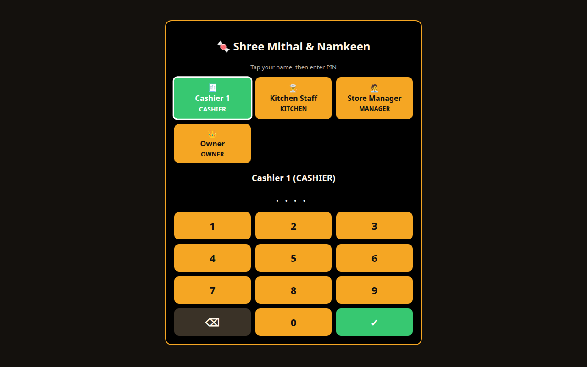

# 🍬 Indian Sweet Shop POS — Mithai & Namkeen Store System

Offline-first Point-of-Sale + store management for an Indian sweet shop.
Handles festive rushes, dual-unit (weight/piece) inventory, gift-box assembly,
GST billing, and multi-mode payments.

Stack: a **Flask + SQLite** backend (`app.py` + `pos/`) serving a **React 19**
frontend (`web/`), packaged as a browser app, a desktop shell (Electron), or a
container (Docker). All data stays local in a single `sweetshop.db` file.

## Quick start

```bash
./run.sh                 # opens http://127.0.0.1:5000 in your browser
./run.sh --no-browser    # server only
./run.sh --port 5001     # if port 5000 is busy
```

Keep the terminal open while you use the POS. The POS opens on a login screen —
tap your name, enter your PIN on the touch pad:



## Run on Windows

No Linux needed — same app, same bills:

1. Install **Python 3.11+** from python.org — tick **“Add python.exe to PATH”**.
2. Copy the project folder to the shop PC (skip `.venv/`, `sweetshop.db*`).
3. Double-click **`run.bat`** — first run creates `.venv-win/` and installs Flask
   (internet needed once), then the browser opens at `http://127.0.0.1:5000`.
4. Keep the black window open while billing; close it to stop.

Notes: custom DB path via `set SWEETSHOP_DB=D:\data\shop.db` before launching;
if port 5000 is taken, run `.venv-win\Scripts\python.exe app.py --port 5001`;
allow the Firewall prompt for **private networks** if shown. For a no-Python
single file, build the `.exe` on the Windows PC:
`py -m pip install pyinstaller && py -m PyInstaller --onefile --name IndianSweetShopPOS --add-data "web/dist;web/dist" --add-data "schema.sql;." app.py`
→ `dist\IndianSweetShopPOS.exe` (DB is created next to the exe).

## Run with Docker

No Python/Node install needed — the image builds the React UI and serves the
API + UI via Flask/gunicorn:

```bash
docker compose up -d --build     # then open http://localhost:5000
docker compose logs -f           # follow logs
docker compose down              # stop (data stays in the named volume)
```

The SQLite DB lives on the `sweetshop-data` volume (`/data/sweetshop.db`), so
`down` won't lose data. To use an existing DB file, mount it and point
`SWEETSHOP_DB` at it. Plain `docker run` works too:

```bash
docker build -t indian-sweet-shop-pos .
docker run -d -p 5000:5000 -v sweetshop-data:/data --name indian-sweet-shop-pos indian-sweet-shop-pos
```

Docker on a Windows/macOS shop PC works the same via Docker Desktop.

Demo logins (username / PIN):

| User | PIN | Role |
|---|---|---|
| `cashier` | `1234` | Cashier — bill, hold, small voids |
| `kitchen` | `2222` | Kitchen — produce, waste, stock-in |
| `manager` | `1111` | Manager — discounts, voids, stock, catalog |
| `owner` | `0000` | Owner — everything + P&L |

Log in on the touchscreen (tap name + PIN); discount/void/production
actions additionally ask for a manager PIN. Use ⏻ Logout between staff
so the next person logs in fresh.

## Features

- **Catalog matrix** — weight items (price/kg), piece items, barcoded
  pre-packs (`product_variants`), gift-box configs (`box_configs`), per-item
  **sale prices** with date windows, realistic
  per-sweet artwork (`web/public/food/`, drawn by `tools/make_food_icons.py`;
  extend `FOOD_IMG` in `web/src/api.js` for new items, emoji fallback included)
- **Checkout** — touch grid, Takeaway/Dine-in/Bulk/Delivery, Cash (change calc),
  UPI intent link, Card, Split, store credit; Hold & Resume; barcode scan
- **Gift Box Builder** — 500g/1kg/custom boxes, live capacity, packing charges,
  FIFO stock deduction per sweet
- **Inventory & production** — counter batches with expiry, raw-material ledger,
  recipes/BOM, one-tap kitchen production with batch costing, waste log,
  low-stock + 48h-expiry alerts, suppliers + goods receipts
- **🧰 Manage panel** (manager/owner) — edit raw materials (stock, reorder level,
  ₹/unit), build recipes/BOM, rename categories, and see a **reorder** list of
  everything below its reorder level
- **Stock tools** — physical-count adjustment, per-batch expiry view with
  one-click **discard**, and type-ahead restock of existing items
- **Backup & restore** — download the database (💾) and restore from a `.db`
  file (♻) from ⚙ Store, with an automatic pre-restore safety copy; plus
  **CSV exports** (sales, inventory) in Reports
- **RBAC + audit** — 4 roles, manager PIN gates, every discount/void/drawer/stock
  event in `audit_logs`
- **GST + reports** — 5/12/18% slabs with HSN on bills, Z-report, fast/slow movers,
  wastage-vs-sales, owner P&L with BOM-based COGS
- **Hardware** — serial-scale parser + audit log, ESC/POS 32/42-col, drawer kick,
  keyboard shortcuts (F1 Cash · F2 UPI · F5 Hold · Space search)
- **Offline sync** — `synced_to_cloud` flags, order push + catalog pull endpoints
- **In-app help** — `? Help` button renders `USER_GUIDE.md` inside the POS
- **Store settings (owner)** — shop name, address, phone, GSTIN, UPI ID and
  receipt footer via ⚙ Store; used on bills, UPI links, thermal + A4 receipts

User manual: [`USER_GUIDE.md`](USER_GUIDE.md).

## Screenshots & themes

The POS ships with three touchscreen themes — **Dark** (default), **Light**,
and **Hi-Contrast** — switchable from the header (saved per terminal).


## Electron desktop shell

The React POS also runs as a desktop app — same Flask API, full feature parity
(login, grid, quantities, split/discount/void, gift boxes, holds, reports +
trend chart, aggregator, back office, settings, themes):


```bash
cd web && npm install
npm run dev          # Vite :5173, proxies /api -> Flask :5000 (run ./run.sh too)
npm run build        # bundle, served by Flask at /
npx electron .       # desktop shell (needs a display; uses Vite dev or dist/)
npm run dist         # .exe (nsis) + .deb via electron-builder — build on Windows for the .exe
```

Notes: the Electron GUI can't launch in headless containers (verified via the
identical Chromium engine instead — login → bill → receipt, zero JS errors).
`npm run dist` on Linux produces the `.deb`; produce the Windows `.exe` by
running the same command on a Windows PC.

## Project structure

```
app.py               Flask POS backend (SQLite) — serves the React build at /
run.sh               one-command launcher (uses .venv)
run.bat              Windows double-click launcher
Dockerfile           multi-stage image (Node build + Flask/gunicorn runtime)
docker-compose.yml   one-command run with a persistent DB volume
docker-entrypoint.sh init/migrate/seed the DB, then start gunicorn
schema.sql           SQLite schema (base tables)
pos/                 database.py (init + idempotent deltas + seed)
                     pricing.py (Decimal pricing, gift-box math)
                     hardware.py (scale parser, ESC/POS, drawer)
web/                 React 19 + Vite POS (the only frontend) + Electron shell (electron/)
tools/               make_food_icons.py (per-sweet artwork)
```

## API overview

| Area | Endpoints |
|---|---|
| Catalog | `GET /api/products /categories /box-configs`, `GET /api/scan?barcode=` |
| Catalog admin | `POST/PUT /api/categories`, `POST/PUT/DELETE /api/raw-materials`, `GET/POST/PUT/DELETE /api/recipes`, `PUT/DELETE /api/products/<id>` |
| Inventory | `POST /api/stock/adjust`, `GET /api/batches?product_id=`, `POST /api/batches/<id>/discard`, `GET /api/reorder` |
| Pricing | `POST /api/cart/price`, `POST /api/giftbox/validate`, `POST /api/scale/read` |
| Orders | `POST /api/orders` (discount, split, gift boxes), `POST /api/orders/<id>/void`, `GET /api/orders/<id>/receipt`, hold/resume, `PATCH /api/orders/<id>/agg` |
| Back office | `POST /api/production /stockin /waste`, `GET/POST /api/suppliers /box-configs` |
| Reports | `GET /api/reports/zreport /summary /wastage /pnl`, `GET /api/reports/sales?group=daily\|monthly\|yearly&from=&to=`, `GET /api/audit` |
| Export / backup | `GET /api/reports/sales.csv`, `GET /api/inventory.csv`, `GET /api/backup`, `POST /api/restore` |
| Sync/hardware | `POST /api/sync`, `GET/POST /api/sync/catalog`, `POST /api/printer/print /drawer/kick` |

## Development

```bash
.venv/bin/pip install -r requirements.txt   # flask
./run.sh --no-browser &                      # start server
curl localhost:5000/api/products             # smoke test
(cd web && npm run build)                    # bundle the React UI, served by Flask
(cd web && npx oxlint)                       # lint the React UI
```
