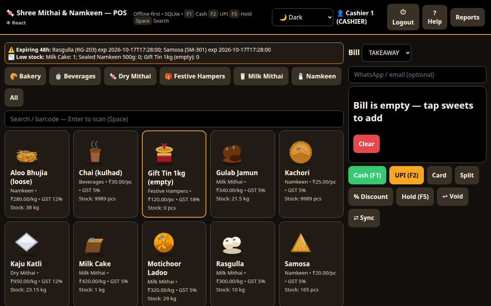
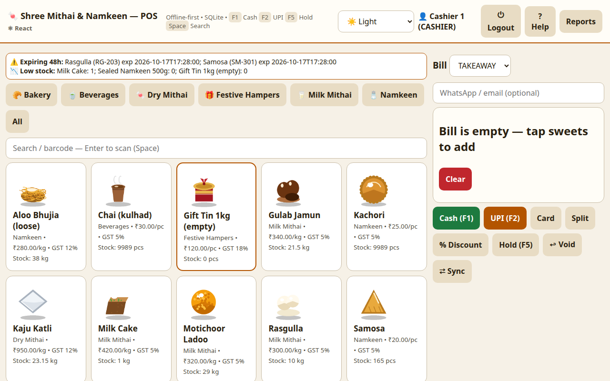
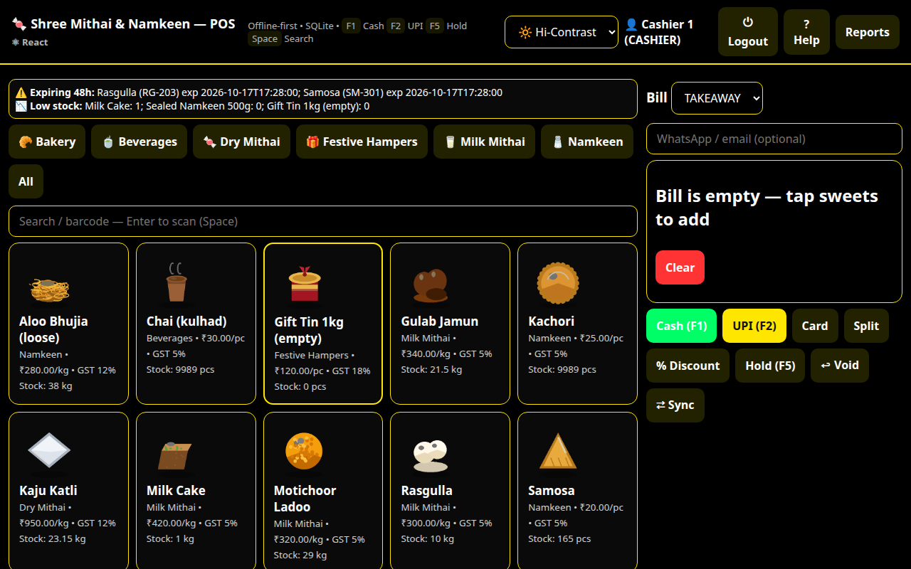
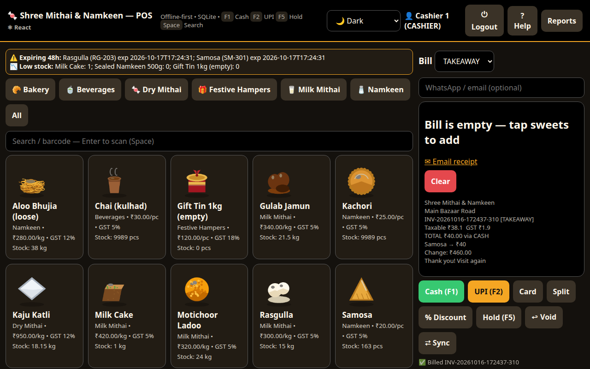

# 🍬 Indian Sweet Shop POS — Mithai & Namkeen Store System

Offline-first Point-of-Sale + store management for an Indian sweet shop.
Handles festive rushes, dual-unit (weight/piece) inventory, gift-box assembly,
GST billing, and multi-mode payments.

Stack: a **Flask + SQLite** backend (`app.py` + `pos/`) serving a **React 19**
frontend (`web/`), packaged as a browser app, a desktop shell (Electron), or a
container (Docker). All data stays local in a single `sweetshop.db` file.

## 🚀 Quick Start & Launch Guide

The POS runs identically on **Linux** and **Windows** with full offline support and local SQLite storage.

---

### 🐧 Launching on Linux

#### 1. Prerequisites
- **Python 3.10+** (with venv support):
  ```bash
  sudo apt update && sudo apt install python3 python3-venv python3-pip
  ```
- **Node.js 18+** *(optional, only needed if modifying or rebuilding the web UI)*

#### 2. Start the App
Run the launcher script:
```bash
./run.sh
```
> **What it does automatically:**
> - Creates the local Python virtual environment (`.venv/`) on first run.
> - Installs required dependencies from `requirements.txt`.
> - Verifies/builds the web UI bundle if missing.
> - Launches the Flask + SQLite engine and opens `http://127.0.0.1:5000` in your default browser.

#### 3. Command-Line Options
```bash
./run.sh --port 5001       # Change listening port if 5000 is occupied
./run.sh --no-browser      # Start server in background without launching browser
```

#### 4. Custom Database Location
To store the database on another disk, drive, or backup mount:
```bash
SWEETSHOP_DB=/var/data/sweetshop.db ./run.sh
```

#### 5. Electron Desktop Mode (Linux)
To run as a native framed desktop app:
```bash
cd web
npm install
npx electron .
```
To generate an installable `.deb` package: `npm run dist` inside `web/`.

---

### 🪟 Launching on Windows

#### 1. Prerequisites
1. Download & install **Python 3.10+** from [python.org](https://www.python.org/downloads/).
   > ⚠️ **Important:** During installation, check the box **"Add python.exe to PATH"**.
2. **Node.js 18+** from [nodejs.org](https://nodejs.org/) *(optional, only needed if rebuilding frontend)*.

#### 2. Start the App (One-Click)
- Simply **double-click `run.bat`** in the project folder.
- Or open **Command Prompt / PowerShell** in the project folder and type:
  ```cmd
  run.bat
  ```

> **What it does automatically:**
> - Detects Python and creates a dedicated Windows virtual environment (`.venv-win\`) on first run.
> - Installs all dependencies from `requirements.txt`.
> - Builds the web assets if missing.
> - Starts the local server and opens your web browser at `http://127.0.0.1:5000`.
> - Keep the command window open while operating; close it or press `Ctrl+C` to shut down.

#### 3. Windows Command-Line Options
```cmd
run.bat --port 5001        :: Run on port 5001
run.bat --no-browser       :: Launch server without popping up the browser
```

#### 4. Custom Database Location (Windows)
```cmd
set SWEETSHOP_DB=D:\SweetShopData\shop.db
run.bat
```

#### 5. Windows Desktop App & Standalone EXE
- **Native Electron Desktop App**:
  ```cmd
  cd web
  npm install
  npx electron .
  ```
- **Generate Windows Installer (`.exe` / NSIS)**:
  ```cmd
  cd web
  npm run dist
  ```
- **Single-File Portable EXE (PyInstaller)**:
  ```cmd
  py -m pip install pyinstaller
  py -m PyInstaller --onefile --name IndianSweetShopPOS --add-data "web/dist;web/dist" --add-data "schema.sql;." app.py
  ```
  The compiled portable executable will be placed in `dist\IndianSweetShopPOS.exe`.

---

### 🐳 Run with Docker (Cross-Platform)

No Python or Node installation needed — the multi-stage Docker image builds the web bundle and runs Flask with Gunicorn:

```bash
docker compose up -d --build     # starts container on http://localhost:5000
docker compose logs -f           # monitor logs
docker compose down              # stop container (data remains preserved in volume)
```

The database persists in the `sweetshop-data` Docker volume (`/data/sweetshop.db`).

---

### 👥 Default Demo Credentials

Tap user tile on the login screen and enter the corresponding 4-digit PIN:

| User | Role | PIN | Permissions |
|---|---|---|---|
| `cashier` | Cashier | `1234` | Billing, holds, item lookup, voids up to ₹1,000 |
| `kitchen` | Kitchen | `2222` | Made fresh (BOM production), batch wastage, stock-in |
| `manager` | Manager | `1111` | Overrides, discounts, all voids, catalog & recipe management |
| `owner` | Owner | `0000` | Full administrative control, store settings, backups, P&L reports |


Log in on the touchscreen (tap name + PIN); discount/void/production
actions additionally ask for a manager PIN. Use ⏻ Logout between staff
so the next person logs in fresh.

## Features

- **Catalog matrix** — weight items (price/kg), piece items, barcoded
  pre-packs (`product_variants`), gift-box configs (`box_configs`), per-item
  **sale prices** with date windows, realistic
  per-sweet artwork (`web/public/food/`, drawn by `tools/make_food_icons.py`;
  extend `FOOD_IMG` in `web/src/api.js` for new items, emoji fallback included)
- **Checkout** — touch grid, Takeaway/Dine-in/Bulk/Delivery, Cash (change calc),
  UPI intent link, Card, Split, store credit; Hold & Resume; barcode scan
- **Gift Box Builder** — 500g/1kg/custom boxes, live capacity, packing charges,
  FIFO stock deduction per sweet
- **Inventory & production** — counter batches with expiry, raw-material ledger,
  recipes/BOM, one-tap kitchen production with batch costing, waste log,
  low-stock + 48h-expiry alerts, suppliers + goods receipts
- **🧰 Manage panel** (manager/owner) — edit raw materials (stock, reorder level,
  ₹/unit), build recipes/BOM, rename categories, and see a **reorder** list of
  everything below its reorder level
- **Stock tools** — physical-count adjustment, per-batch expiry view with
  one-click **discard**, and type-ahead restock of existing items
- **Backup & restore** — download the database (💾) and restore from a `.db`
  file (♻) from ⚙ Store, with an automatic pre-restore safety copy; plus
  **CSV exports** (sales, inventory) in Reports
- **RBAC + audit** — 4 roles, manager PIN gates, every discount/void/drawer/stock
  event in `audit_logs`
- **GST + reports** — 5/12/18% slabs with HSN on bills, Z-report, fast/slow movers,
  wastage-vs-sales, owner P&L with BOM-based COGS
- **Hardware** — serial-scale parser + audit log, ESC/POS 32/42-col, drawer kick,
  keyboard shortcuts (F1 Cash · F2 UPI · F5 Hold · Space search)
- **Offline sync** — `synced_to_cloud` flags, order push + catalog pull endpoints
- **In-app help** — `? Help` button renders `USER_GUIDE.md` inside the POS
- **Store settings (owner)** — shop name, address, phone, GSTIN, UPI ID and
  receipt footer via ⚙ Store; used on bills, UPI links, thermal + A4 receipts

User manual: [`USER_GUIDE.md`](USER_GUIDE.md).

## Screenshots & themes

The POS ships with three touchscreen themes — **Dark** (default), **Light**,
and **Hi-Contrast** — switchable from the header (saved per terminal).





## Electron desktop shell

The React POS also runs as a desktop app — same Flask API, full feature parity
(login, grid, quantities, split/discount/void, gift boxes, holds, reports +
trend chart, aggregator, back office, settings, themes):



```bash
cd web && npm install
npm run dev          # Vite :5173, proxies /api -> Flask :5000 (run ./run.sh too)
npm run build        # bundle, served by Flask at /
npx electron .       # desktop shell (needs a display; uses Vite dev or dist/)
npm run dist         # .exe (nsis) + .deb via electron-builder — build on Windows for the .exe
```

Notes: the Electron GUI can't launch in headless containers (verified via the
identical Chromium engine instead — login → bill → receipt, zero JS errors).
`npm run dist` on Linux produces the `.deb`; produce the Windows `.exe` by
running the same command on a Windows PC.

## Project structure

```
app.py               Flask POS backend (SQLite) — serves the React build at /
run.sh               one-command launcher (uses .venv)
run.bat              Windows double-click launcher
Dockerfile           multi-stage image (Node build + Flask/gunicorn runtime)
docker-compose.yml   one-command run with a persistent DB volume
docker-entrypoint.sh init/migrate/seed the DB, then start gunicorn
schema.sql           SQLite schema (base tables)
pos/                 database.py (init + idempotent deltas + seed)
                     pricing.py (Decimal pricing, gift-box math)
                     hardware.py (scale parser, ESC/POS, drawer)
web/                 React 19 + Vite POS (the only frontend) + Electron shell (electron/)
tools/               make_food_icons.py (per-sweet artwork)
```

## API overview

| Area | Endpoints |
|---|---|
| Catalog | `GET /api/products /categories /box-configs`, `GET /api/scan?barcode=` |
| Catalog admin | `POST/PUT /api/categories`, `POST/PUT/DELETE /api/raw-materials`, `GET/POST/PUT/DELETE /api/recipes`, `PUT/DELETE /api/products/<id>` |
| Inventory | `POST /api/stock/adjust`, `GET /api/batches?product_id=`, `POST /api/batches/<id>/discard`, `GET /api/reorder` |
| Pricing | `POST /api/cart/price`, `POST /api/giftbox/validate`, `POST /api/scale/read` |
| Orders | `POST /api/orders` (discount, split, gift boxes), `POST /api/orders/<id>/void`, `GET /api/orders/<id>/receipt`, hold/resume, `PATCH /api/orders/<id>/agg` |
| Back office | `POST /api/production /stockin /waste`, `GET/POST /api/suppliers /box-configs` |
| Reports | `GET /api/reports/zreport /summary /wastage /pnl`, `GET /api/reports/sales?group=daily\|monthly\|yearly&from=&to=`, `GET /api/audit` |
| Export / backup | `GET /api/reports/sales.csv`, `GET /api/inventory.csv`, `GET /api/backup`, `POST /api/restore` |
| Sync/hardware | `POST /api/sync`, `GET/POST /api/sync/catalog`, `POST /api/printer/print /drawer/kick` |

## Development

```bash
.venv/bin/pip install -r requirements.txt   # flask
./run.sh --no-browser &                      # start server
curl localhost:5000/api/products             # smoke test
(cd web && npm run build)                    # bundle the React UI, served by Flask
(cd web && npx oxlint)                       # lint the React UI
```
