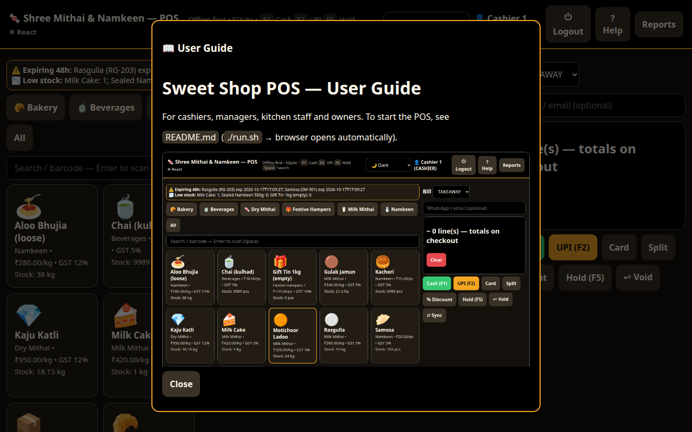
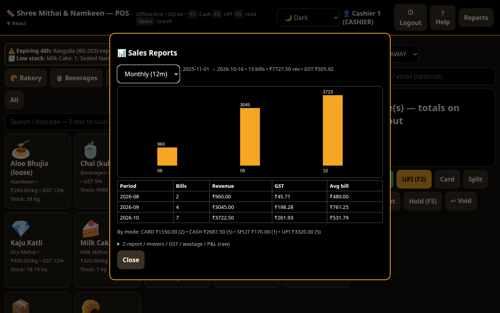
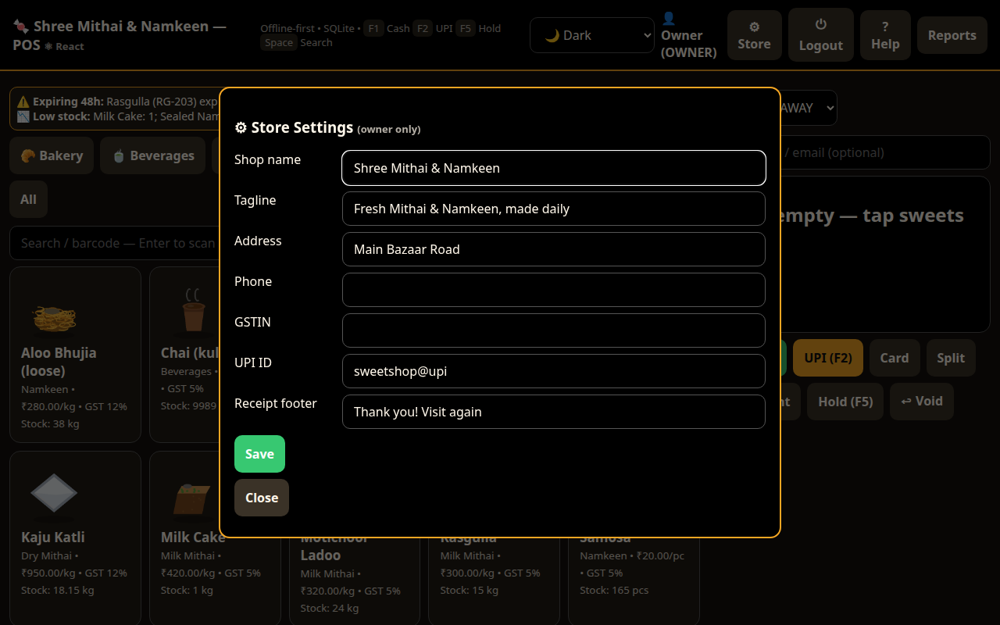

# Indian Sweet Shop POS — User Guide

For cashiers, managers, kitchen staff and owners. To start the POS, see
`README.md` (`./run.sh` → browser opens automatically).


> The header theme switcher offers Dark, Light and Hi-Contrast —
> pick what reads best on your counter terminal; it remembers the choice.
> Tap **? Help** anytime to read this guide inside the POS:



## 1. Daily routine (cashier)

1. Open `./run.sh`, keep the terminal open, use the browser window (or start
   the packaged app — `run.bat` on Windows, `docker compose up -d` for Docker,
   or pull the published image from Docker Hub (§11); see `README.md`).
2. Log in: tap your name on the login screen, enter your 4-digit PIN on the
   touch pad. Your name and role show top-right; **⏻ Logout** between staff.
3. Tap a sweet tile on the left — no popups. Piece items add 1 per tap (repeat
   taps merge; −/+ adjusts). Weight items add 500g; change the grams inline.
   The bill panel on the right shows the running **Total**.
4. Take payment with the big buttons: **💵 Cash (F1)** · **📲 UPI (F2)** ·
   **💳 Card** · **Split**. Cash opens a tender box — type the cash received
   (or tap Exact / ₹100 / ₹200 / ₹500 / ₹1000 / ₹2000) and it shows the
   **balance to return**; **Complete sale** finishes the bill. UPI shows a
   tap-to-pay link.
5. The receipt then shows the total, cash received and balance, with a
   **🖨 Print receipt** button (and **New bill** to start the next customer);
   you can also send a digital receipt (§6).

Everything else (Box Builder, Stock, Holds, Scale, Reports, Manage, Store,
Sync, theme, Help) lives under the **☰ Menu** in the header, so the billing
screen stays uncluttered.

**Shortcuts:** `F1` Cash · `F2` UPI · `F5` Hold · `Space` search/scan box.
Order type (Takeaway/Dine-in/Bulk/Delivery) and an optional customer phone sit
just above the payment buttons.

## 2. Search & barcode

- Type in the search box to filter the grid; category buttons filter by
  Mithai (Milk/Dry), Namkeen, Bakery, Beverages, Hampers.
- For sealed packs, scan (or type + **Enter**) the barcode —
  e.g. `8901234567890` adds *Sealed Namkeen 500g*. Unmatched codes just filter
  the grid.

## 3. Gift Box Builder 🎁

1. **Box Builder** → pick a box size (500g / 1kg / custom, packing charge fills in).
2. **+ Add sweet** per variety, set grams each — the capacity check warns on overflow.
3. **Add box to bill** — each sweet is deducted from its own fresh stock batch.

## 4. Discounts, holds, voids

- **% Discount** — needs a manager (auto-approved if your role is Manager/Owner,
  else it asks for a manager username + PIN). Enter amount + reason; it prints on
  the bill and in the audit log.
- **Hold (F5)** — parks the current bill during a rush; **Holds** recalls it.
- **↩ Void** — enter the invoice number (e.g. `INV-20261016-162651-885`) to return
  a bill; stock is restocked automatically. Cashiers can void up to ₹1000;
  bigger voids need a manager.

## 5. Kitchen & stock (manager/kitchen)

**📦 Stock** is one screen with three tabs:

- **➕ Add stock** — the top **New item** box creates a sweet *and* stocks it in
  one step (name, category, per kg / per pc, price, opening qty → **Create &
  add stock**). Below it, search and tap an item (switch the dropdown to *Raw
  materials* for sugar/khoya), set the qty with −/+, then **Add stock**.
- Selecting an item also reveals **✏️ Edit item** (name, category, unit, price),
  **⚖️ Adjust count** (physical count — type what is on the shelf and the
  difference is logged) and **🕒 Batches** (each batch with its expiry and a
  one-click **Discard**).
- **🏭 Made fresh** — kitchen yield: raws deduct per recipe, batch cost shown
  (e.g. 5 kg Ladoo → ₹780). Fails safely naming what's short. Needs a recipe —
  set one up in 🧰 Manage (below).
- **🗑 Waste** — spoilage/tasting/staff-meals against the oldest fresh batch.

Low-stock and 48-hour-expiry warnings sit above the grid.

### 🧰 Manage panel (manager/owner)

Header → **🧰 Manage**:

- **🥣 Raw materials** — add / edit / delete raws, set stock, reorder level, ₹/unit.
- **📋 Recipes** — pick a product and add ingredient lines (raw + qty per unit);
  shows the material cost per unit that “Made fresh” uses.
- **🏷 Categories** — add and rename categories.
- **🛒 Reorder** — suggested purchase list of products and raws at/below their
  reorder level.

## 6. Bills & receipts

- Thermal print is automatic (3-inch default, 4-inch supported) and shows the
  shop name, address, **phone, GSTIN and UPI ID** from ⚙ Store along with the
  GST breakdown.
- After a sale, the receipt panel has a **🖨 Print receipt** button (prints the
  current bill), alongside the automatic thermal print.
- **🖨 A4 Bill** prints a GST invoice with HSN codes (uses the last bill).
- After each bill, share links appear: **UPI pay** (UPI bills), **WhatsApp
  receipt** (uses the phone number you typed), **Email receipt**.
- **🛵 Aggregator** shows today's Delivery/Bulk bills with Zomato/Swiggy-style
  status (NEW → PREPARING → READY → PICKED → DELIVERED); tap **Advance** as the
  order moves.

## 7. Scale, printer, drawer

- **⚖️ Scale** — paste/type the scale readout (e.g. `ST,GS  0.345kg`); it is
  validated (unknown units like `99.0t` are rejected, not misread) and logged.
  A live RS232/USB scale feeds the same path in the desktop build.
- Cash bills kick the drawer automatically; manual kicks are audit-logged
  with a reason.

## 8. Reports (manager/owner)

**Reports** opens a sales dashboard: switch **Daily (30d) / Monthly (12m) /
Yearly** for a trend chart plus a period table (bills, revenue, GST, avg bill)
and payment-mode mix. Below it: Z-report (today's payment-mode totals),
fast- vs slow-moving sweets, GST breakup by slab, wastage-vs-sales, and
(Owner/Manager) **P&L** — revenue, discounts, recipe-based food cost, waste
value, gross profit. **⬇ Sales CSV** and **⬇ Inventory CSV** download the data
for Excel/accounting.



## 9. Store settings (owner)

Log in as Owner → **⚙ Store**: shop name, tagline, address, phone, GSTIN,
UPI ID and receipt footer. They apply immediately to the header, bills,
UPI pay links, thermal prints and A4 invoices. Other roles don't see the
button, and the API rejects non-owner edits.

Below the settings: **💾 Backup database** downloads a copy of
`sweetshop.db`, and **♻ Restore from backup** replaces all data from a chosen
`.db` file (a pre-restore safety copy is kept, and invalid files are rejected).



## 10. Closing the day

1. Open **Reports** → Z-report; count the drawer against Cash + opening float.
2. **⇄ Sync** pushes the day's bills to cloud when internet is available
   (the POS works fully offline; a counter shows what synced).
3. Take a **⚙ Store → 💾 Backup** copy now and then (e.g. end of day).
4. Close the terminal (Ctrl+C) to stop the POS.

## 11. Install from Docker Hub

If Docker (or Docker Desktop on Windows/macOS) is installed, you can run the
POS without building anything from source.

1. Download the published image:

   ```bash
   docker pull vipul/indian-sweet-shop-pos:latest
   ```

2. Start the container (the named volume keeps `sweetshop.db` between runs):

   ```bash
   docker run -d --name indian-sweet-shop-pos \
     -p 5000:5000 \
     -v sweetshop-data:/data \
     -e SWEETSHOP_DB=/data/sweetshop.db \
     --restart unless-stopped \
     vipul/indian-sweet-shop-pos:latest
   ```

3. Open `http://localhost:5000` and log in with the demo users in `README.md`
   (`cashier` / `1234`, `manager` / `1111`, `owner` / `0000`). The first start
   creates and seeds the database automatically.

   ```bash
   docker logs -f indian-sweet-shop-pos   # follow startup logs
   docker stop indian-sweet-shop-pos      # stop (data stays in the volume)
   ```

**Update to a newer image:** take a backup first (⚙ Store → 💾 Backup
database), then pull and recreate the container — the `-v sweetshop-data:/data`
volume is preserved:

```bash
docker pull vipul/indian-sweet-shop-pos:latest
docker stop indian-sweet-shop-pos && docker rm indian-sweet-shop-pos
# run the docker run command from step 2 again
```

To use the image with Compose, replace `build: .` in `docker-compose.yml` with
`image: vipul/indian-sweet-shop-pos:latest`, then run `docker compose up -d`
(no `--build`). Use a different host port (e.g. `-p 5001:5000`) if port 5000 is
already taken.

## 12. Troubleshooting

| Problem | Fix |
|---|---|
| Browser shows nothing / won't open | Open `http://127.0.0.1:5000` manually; keep terminal open |
| `Address already in use` | `./run.sh --port 5001` |
| Running with Docker | Build from source with `docker compose up -d --build`, or install from Docker Hub (§11); open `http://localhost:5000`; data lives in the `sweetshop-data` volume |
| Need to move / recover data | ⚙ Store → 💾 Backup, then ♻ Restore on the other machine (a pre-restore safety copy is kept) |
| Discount/void says “Not authorized” | Use manager PIN (`manager` / `1111`) or switch role |
| Production says “no recipe/BOM” | Add a recipe for the product in 🧰 Manage → Recipes |
| Production says “insufficient raw stock” | **Stock-In** the named raws first (📦 Stock → Add stock → Raw materials) |
| Barcode not found | Check the code; new barcodes are registered in the product catalog via catalog sync (manager) |
| Printer doesn't print | Check USB path (`PRINTER_PATH`) or set `PRINTER_TCP=host:port` |
| Reports show zeros | No bills yet today — bill something first. Fresh installs include 3 DEMO bills + 1 waste entry so every report has data; void them (↩ Void, `INV-DEMO-*`) to start clean |
| Start completely fresh | Stop server, delete `sweetshop.db*`, run `./run.sh` (reseeds demo data) |
