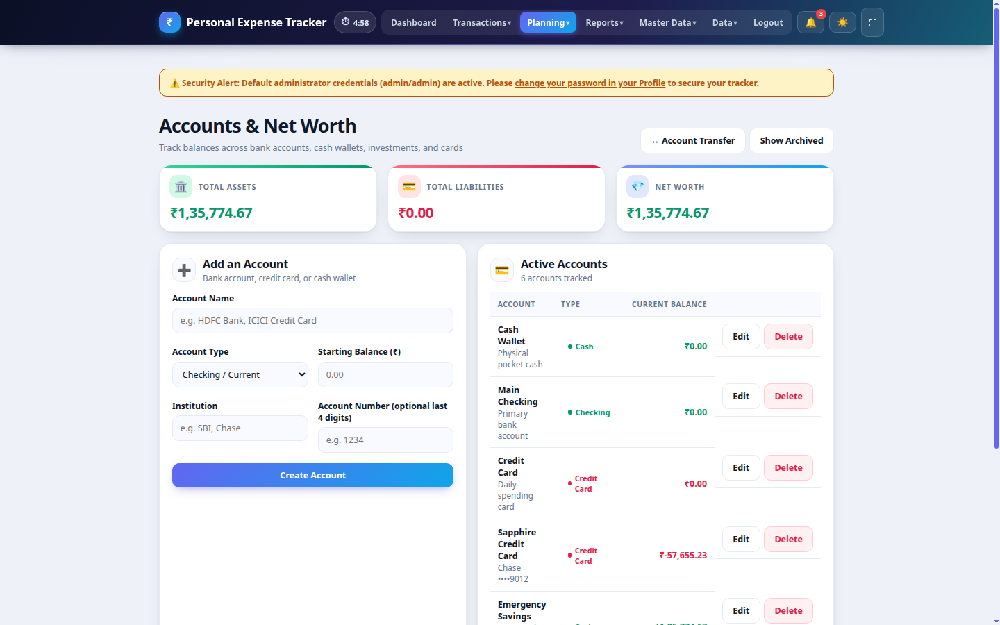
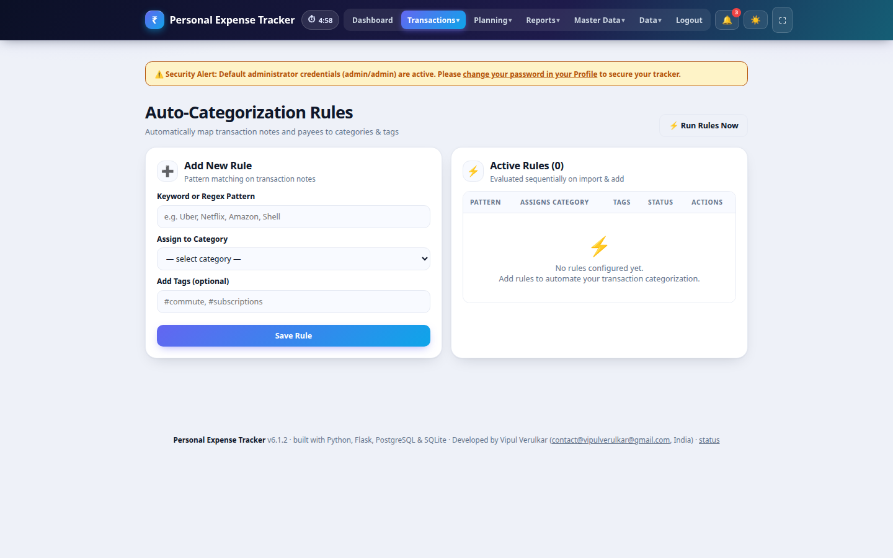
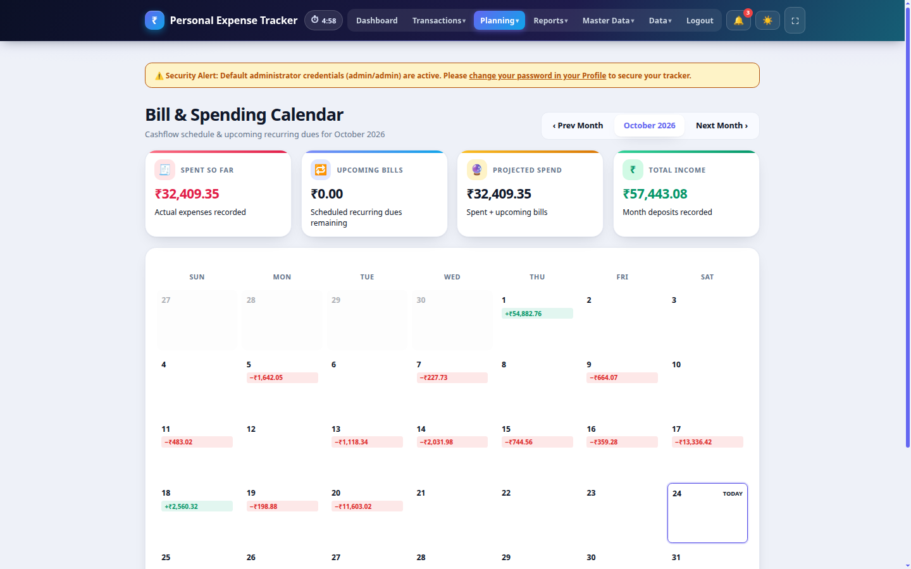
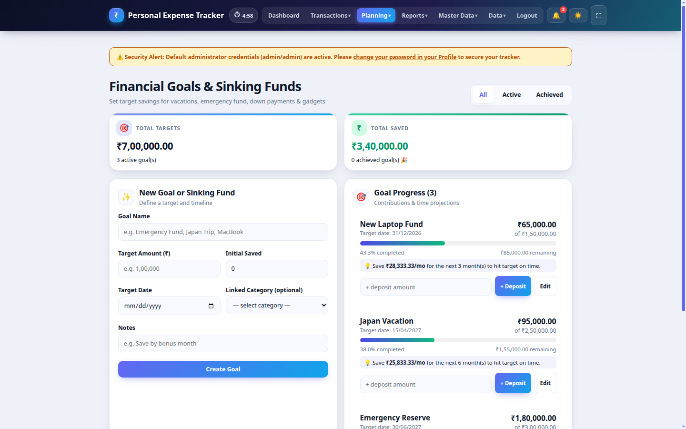
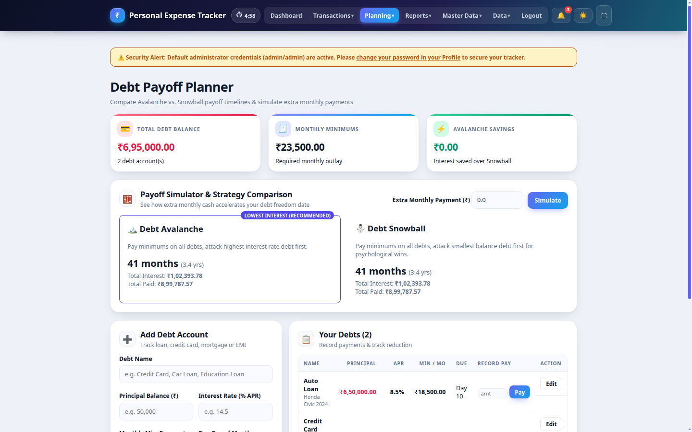
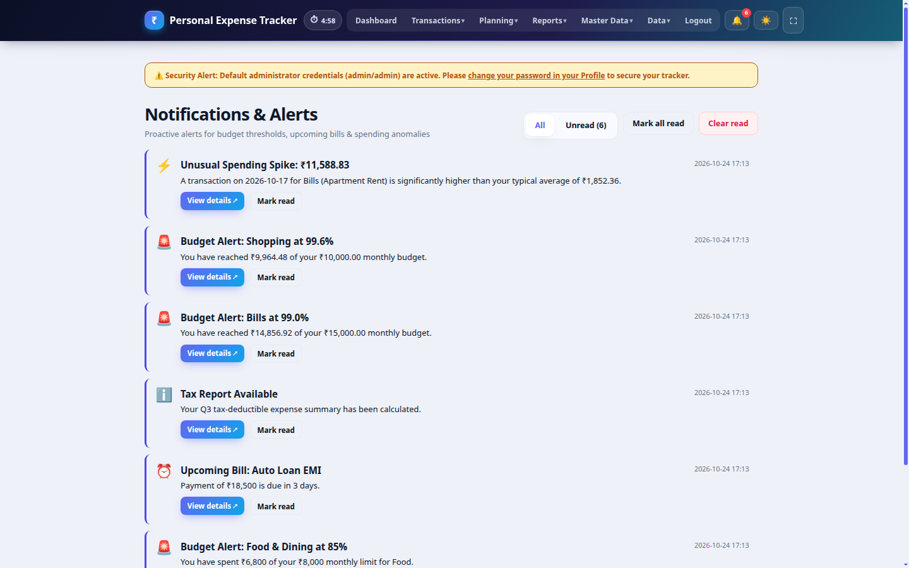
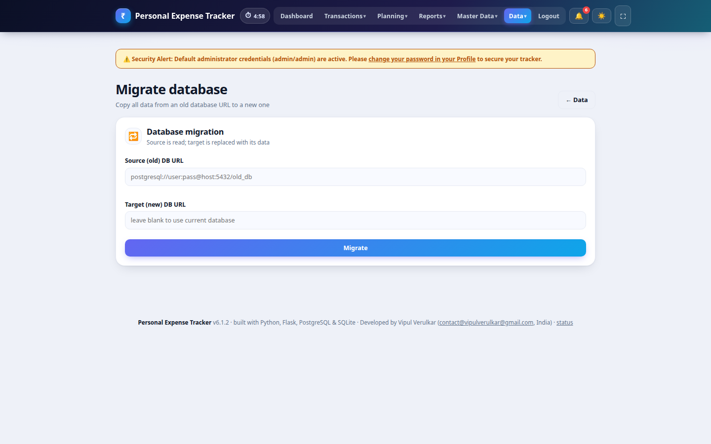

# User Guide — Personal Expense Tracker

A comprehensive day-to-day guide to every screen, feature, and workflow. For technical architecture and data design, see [`ARCHITECTURE.md`](ARCHITECTURE.md).

## Artifacts & Downloads

- **GitHub Releases:** [Releases Page](https://github.com/vipulverulkar/Exp_tracker_V6.1_with_docker_postgres_and_sqllite/releases) — download prebuilt standalone desktop executables and offline Docker archives.
- **Desktop Builds (Linux / Windows):** [CI/CD Workflow Artifacts](https://github.com/vipulverulkar/Exp_tracker_V6.1_with_docker_postgres_and_sqllite/actions/workflows/ci_cd.yml) — download `Personal-Expense-Tracker_v6.1.2_linux` or `Personal-Expense-Tracker_v6.1.2_windows`.
- **Docker Image:** [`vipulverulkar/personal-expense-tracker-v6.1`](https://hub.docker.com/r/vipulverulkar/personal-expense-tracker-v6.1) on Docker Hub.
- **Source Code:** [GitHub Repository](https://github.com/vipulverulkar/Exp_tracker_V6.1_with_docker_postgres_and_sqllite).

---

## 1. Signing In

1. Open the app in your browser (default `http://127.0.0.1:5000` or desktop application).
2. Sign in with the seeded credentials: **`admin` / `admin`** (unless modified).
3. **Change the password immediately** from **Master Data ▾ → Users** or directly in the database.


If two-factor authentication (TOTP) is enabled on your account, enter the 6-digit verification code from your authenticator app (Google Authenticator, Authy, 1Password, etc.).

Sessions are managed server-side and are idle-timed (default **5 minutes**). A live countdown shows in the top navigation bar. Any activity resets the timer; reaching zero automatically logs you out securely.

---

## 2. Roles & Permissions

| Capability | Admin | Viewer |
|---|:--:|:--:|
| Browse dashboard, transactions, reports, budgets, categories, accounts, goals, debts, calendar | ✅ | ✅ |
| Add / edit / duplicate / delete transactions, bulk actions | ✅ | — |
| Create & manage accounts, transfer funds | ✅ | — |
| Create rules, financial goals, debts, and split shared expenses | ✅ | — |
| Manage categories, budgets, rollover, recurring schedules | ✅ | — |
| Ingest bank statements (OFX / QFX / QIF / CSV) | ✅ | — |
| Backup / restore / database migration | ✅ | — |
| Manage users, reset passwords, view audit log | ✅ | — |
| Edit site-wide settings (`app/.env`) | ✅ | — |
| Change personal font zoom and configure personal 2FA | ✅ | ✅ |
| Adjust personal inactivity timeout | ✅ | — |

---

## 3. Navigation Bar

- **Dashboard** — key financial summary metrics (Monthly Total Expense, Yearly Expense, Total Balance), quick transaction entry, recent ledger, and active budget alerts.
- **Accounts** — multi-account ledger, liquid balances, total net worth, and inter-account transfers.
- **Transactions ▾** — All transactions · Recurring · Budgets · Bank import · Rules
- **Planning ▾** — Bill Calendar · Financial Goals · Debt Planner · Shared Expenses
- **Reports ▾** — 📊 Overview · 📅 Daily · 🗓️ Monthly · 📆 Yearly · 📈 Yearly trends · 🌊 Monthly trends · 📋 Tax Deductions · 🏷️ Tags Breakdown · 🏆 Top · 🏷️ Categories · 💡 Insights · 🎯 Budgets · 🔮 Forecast
- **Master Data ▾** — Categories · Users (admin) · Settings (admin) · Profile
- **Data ▾** — Backup & restore · Migrate database (admin) · Audit log (admin)
- **Notifications 🔔** — live alerts badge showing budget warnings and upcoming bill notices.
- **Controls** — dark/light theme toggle (🌙 / ☀️), fullscreen toggle (⛶), and logout.

---

## 4. Dashboard


- **Total balance & Net Worth** — all-time income − spending (savings buckets stay part of your money).
- **Monthly Total Expense & Summary** — current month total expenses, income, saved amounts, and live savings rate percentage.
- **Yearly Expense** — financial year total expenditure card (defaults to Indian Financial Year: 1 Apr – 31 Mar, displaying e.g. FY 2026-27, or configurable to Calendar Year / custom fiscal year in Settings).
- **Month Saved** — money parked in savings buckets during the active month.
- **Active Budgets Counter** — real-time counter of configured budgets and track status.
- **Budget Alerts** — visual warning badges when categories reach 80% (⚠️) or 100% (🚨) of their limits.
- **Quick Add Form** — rapid transaction logging directly from the home screen.
- **Recent Activity Ledger** — live view of recent transactions with category icons, account tags, and inline edit links.
- **Due Schedule Processing** — recurring schedules due for execution run automatically upon dashboard load.

*(Note: The 6-Month Income vs. Expense Trend, Top Spending category breakdown, and active monthly budget cards have been moved to **Reports ▾ → 📊 Overview** for a fast, responsive, and uncluttered home dashboard).*

---

## 5. Accounts & Net Worth



Manage all your financial institutions and account balances in one central hub:

- **Account Types**: Checking, Savings, Credit Card, Cash, Investment, and Loan accounts.
- **Net Worth Metrics**: Automatically calculates **Total Liquid Balance** (cash, checking, savings) and **Total Net Worth** (liquid assets + investments − credit card & loan liabilities).
- **Inter-Account Transfers**: Execute atomic balance transfers between accounts (e.g. Checking to Savings) without skewing income/expense reports.
- **Account Association**: Every transaction can be tagged to a specific account to keep balances reconciled.

---

## 6. Automation Rules Engine



Automate repetitive categorization and tagging tasks:

- **Pattern Matching**: Define regex or substring patterns (e.g., `Uber|Lyft|Metro` or `Starbucks|Cafe`).
- **Target Fields**: Match against transaction notes or merchant description fields.
- **Automated Actions**: Automatically assign target categories and apply comma-separated tags (e.g., `commute,transport` or `dining`).
- **Execution Hook**: Rules run automatically on manual transaction creation and during bulk statement ingestion.

---

## 7. Bill Calendar & Cashflow Forecast



Stay ahead of upcoming financial obligations:

- **Interactive Calendar Grid**: View monthly calendar highlighting due dates for recurring bills, subscription renewals, and scheduled debt payments.
- **Due Status**: Color-coded badges indicate upcoming, due today, and paid commitments.
- **Cashflow Projection**: Summarizes total commitments for the month and projects end-of-month cash buffer.

---

## 8. Financial Goals & Sinking Funds



Plan and save for major life events and purchases:

- **Target Tracking**: Set goal names, target amounts, target dates, and notes (e.g., *Emergency Fund*, *New Car*, *Vacation*).
- **Visual Progress Gauges**: Real-time progress bars showing percentage achieved.
- **Deposit Contributions**: Log incremental savings contributions with one click.
- **Lifecycle Management**: Automatically updates status to **Achieved** upon reaching 100%, with options to archive completed goals.

---

## 9. Debt Payoff Planner



Eliminate liabilities using proven debt acceleration strategies:

- **Debt Ledger**: Track balance, APR interest rate, minimum monthly payment, and payment due day.
- **Interactive Strategy Simulators**:
  - **Avalanche Method**: Prioritizes debts with the highest interest rate first, minimizing total interest paid.
  - **Snowball Method**: Prioritizes debts with the smallest principal balance first, building psychological momentum.
- **Simulation Metrics**: Compares payoff timelines (months to debt-free) and calculates exact interest savings for extra monthly payments.

---

## 10. Shared Group Expenses


Easily split expenses with friends, roommates, or travel partners:

- **Split Assignment**: Split any existing transaction across one or more people with custom share amounts.
- **Participant Balances**: Summarizes net outstanding balances owed by each person.
- **Settlement Tracking**: Mark individual splits as settled or settle an entire person's balance in one click.

---

## 11. Alerts & Notifications Center



Never miss a budget threshold or payment deadline:

- **Proactive Alerts**:
  - Budget warnings (85% and 100% threshold alerts).
  - Upcoming bill and debt payment reminders.
  - System notices and tax report calculations.
- **Badge Indicator**: Live notification counter on the top navigation bar.
- **Action Links**: Direct navigation to the relevant screen (Budgets, Debts, Reports) from each alert card.
- **Mark as Read**: Dismiss notifications individually or mark all as read.

---

## 12. Transactions


### 12.1 Adding Transactions
- **Amount** — integer cents accuracy; formatted with Indian number grouping.
- **Account** — link transaction to a specific bank or cash account.
- **Category** — choose income or expense category.
- **Tags** — custom tags (e.g., `trip:japan`, `holiday`, `tax-deductible`).
- **Tax Deductible** — tick to flag expense for tax deduction reporting.
- **Receipts** — attach images or PDFs (up to 5 MB).
- **Multi-Category Splits** — split one transaction across up to 3 additional categories.

### 12.2 Search, Filtering & Bulk Ops
- Multi-field filters: Type, Category, Account, Tag, Member, and Month.
- Full-text search with PostgreSQL GIN `tsvector` index.
- Bulk actions: tick multiple rows to delete to Trash or re-categorize in batch.
- **Trash**: Soft-deleted entries can be restored or permanently purged.

### 12.3 Transaction Integrity Check
- **One-Click Audit**: Click **`🛡 Integrity Check`** in the Transactions page header (or on the Data management page) to audit ledger consistency.
- **Validation Rules**: Scans for invalid integer cent values, null/blank date or category records, orphaned account or user references, soft-delete state discrepancies, and unassigned entries.
- **Safe & Non-Destructive**: Auto-normalizes fixable anomalies (such as cent rounding, whitespace trimming). It strictly respects unassigned transactions (`account_id IS NULL`) without destructive balance manipulations or forced re-assignment.


---

## 13. Budgets & Rollover


- Set monthly expense limits per category.
- Visual progress bars showing spent, remaining, and percentage used.
- **Edit Budgets**: Adjust existing monthly limits or toggle rollover anytime by clicking **Edit** on any active budget card or selecting the category from the dropdown to automatically prefill its current settings.
- **Budget Rollover**: Unused funds roll over to increase the following month's budget allowance.

---

## 14. Reports & Tax Deductions


- **Comprehensive Views**:
  - **📊 Overview**: Centralized financial intelligence featuring the **Last 6 months** income vs. expense trend chart and table, the **Top spending · this month** donut chart and category breakdown, and **Budgets · this month** progress cards.
  - **📅 Daily & 🗓️ Monthly**: Granular expense breakdowns, daily spending spikes, and monthly cash flow.
  - **📆 Yearly & Trends**: Year-over-year growth, 12-month savings rate history, and multi-year trajectory graphs.
  - **🏆 Top & 🏷️ Categories**: Largest single ticket expenses, category average tickets, and full cross-month category matrix.
  - **💡 Insights**: Weekday vs. weekend spending patterns, per-member spend shares, and recurring commitment ratios.
  - **🎯 Budgets & 🔮 Forecast**: Budget-vs-actual variance and 3-month predictive cashflow forecast.
- **Tax Deductions Summary**: Dedicated reporting view aggregating all tax-deductible expenses by category.
- **Exporting**: One-click export to **PDF**, formatted **Excel (.xlsx)** spreadsheets, and CSV.

| Yearly Trends | Monthly Trends |
|---|---|
|  |  |

---

## 15. Bank Statement Ingestion (OFX / QFX / QIF / CSV)

- **Multi-Format Parser**: Supports standard banking **OFX**, **QFX**, **QIF**, and **CSV** files.
- **Column Mapping**: Auto-detects dates, descriptions, amounts, and debit/credit columns.
- **Rules Execution**: Automatically applies transaction rules to categorize and tag incoming rows.
- **Duplicate Prevention**: Skips duplicate transactions already recorded in the database.

---

## 16. Data, Backups & Migration


- **Full SQL Dump**: Comprehensive backup of all tables, accounts, rules, and transactions.
- **All-Tables CSV Backup**: Download complete tabular data across all features in zipped or individual formats.
- **Desktop Native Downloads**: Direct file save dialogs via the desktop application bridge.
- **Atomic Restore**: Validates backup files before replacing current data.
- **Integrity Validation**: Run **`🛡 Integrity Check`** directly from the Data page to audit ledger integrity and fix fixable anomalies.
- **Database Migration**: Copy records between PostgreSQL databases seamlessly.

### 16.1 Standalone Database & SQL File Locations (Windows & Linux)

When running the standalone desktop executable (`Personal-Expense-Tracker_v6.1.2_windows.exe` or `Personal-Expense-Tracker_v6.1.2_linux`), the app manages its files locally without requiring Docker or an external database server:

#### Windows File Locations
- **Application Data Directory**:
  ```text
  %LOCALAPPDATA%\exptracker\
  (Resolves to: C:\Users\<YourUsername>\AppData\Local\exptracker\)
  ```
  - **`exptracker.db`** — The live SQLite database file containing all transactions, accounts, categories, and settings.
  - **`backups\`** — Automated startup backups and rotation files (`%LOCALAPPDATA%\exptracker\backups\backup_*.sql`).
  - **`.env`** — Configuration overrides saved from the Master Data → Settings screen.
  - **`flask_sessions\`** — Server-side encrypted session tokens.
- **Exported SQL Backups**: When clicking **Backup Database** (`.sql`) in the desktop app, a native Windows **Save As** file dialog opens, allowing you to choose any destination folder (defaults to `C:\Users\<YourUsername>\Downloads\` or `Documents\`). In a standard web browser, it saves directly to your default browser downloads directory.
- **Quick Access**: Press <kbd>Win</kbd> + <kbd>R</kbd>, enter `%LOCALAPPDATA%\exptracker`, and hit **Enter** to open this folder directly in Windows File Explorer.

#### Linux File Locations
- **Application Data Directory**:
  ```text
  ~/.local/share/exptracker/
  (Resolves to: /home/<username>/.local/share/exptracker/)
  ```
  - **`exptracker.db`** — The live embedded SQLite database file.
  - **`backups/`** — Automated startup SQL backup files (`~/.local/share/exptracker/backups/backup_*.sql`).
  - **`.env`** & **`flask_sessions/`** — Application configuration and session storage.
- **Exported SQL Backups**: Native file save dialog prompts where to save (defaults to `~/Downloads/`).
- **Quick Access**: Run `cd ~/.local/share/exptracker` in your terminal.



---

## 17. User Management, Audit & Security

| Users | Audit Log | Site Settings |
|---|---|---|
|  |  |  |

- **User Roles**: Admin and Viewer privileges enforced on the server.
- **Audit Logging**: Tracks deletes, restores, role changes, and administrative actions.
- **Settings Editor**: Configure currency symbols, date formats, financial year start month (defaults to Indian Financial Year: 1 April – 31 March; configurable to Calendar Year or custom fiscal year), rate limits, and database connections.
- **User Profile**: Adjust personal font zoom (70–160%) and configure TOTP 2FA.


